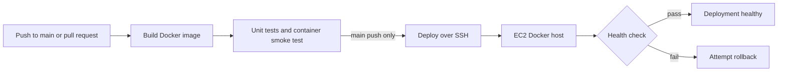

# CI/CD Pipeline for Containerized App Deployment

A small Flask service packaged with Docker, with a GitHub Actions workflow organized into build, test, and deploy stages. The workflow builds a SHA-tagged image, runs unit and container health checks, and is configured to deploy successful pushes to `main` to an EC2 host over SSH with a health check and rollback attempt.

> The repository files are prepared locally. GitHub Actions, GHCR publishing, and EC2 deployment have not been run or provisioned.

## Architecture



Pull requests run build and tests; deployment is limited to pushes on `main`. The image is published to GHCR on a push to `main` and tagged with the commit SHA.

## Application

- `GET /` returns `{"message":"Hello from CI/CD","version":"1.0"}`.
- `GET /health` returns `{"status":"ok"}`.
- Gunicorn serves the app on port `8080` as a non-root user.

## Run locally

Prerequisites: Python 3.12 and Docker (or Docker Compose).

```powershell
py -3.12 -m venv .venv
.\.venv\Scripts\Activate.ps1
python -m pip install -r requirements-dev.txt
python -m pytest -q
```

Build and run the container:

```powershell
docker build -t cicd-demo:local .
docker run --rm -p 8080:8080 --name cicd-demo cicd-demo:local
```

In another terminal, request `http://localhost:8080/health`. Stop the container with Ctrl+C. Alternatively, use `docker compose up --build` and stop it with Ctrl+C.

## Workflow configuration for a future deployment

The deploy job expects a Linux EC2 host with Docker installed, port 80 reachable from the GitHub-hosted runner's deployment target path, and these GitHub repository or `production` environment secrets:

- `EC2_HOST`: server address
- `EC2_USER`: SSH login user
- `EC2_SSH_KEY`: complete private key for a dedicated deploy key

The EC2 host must be able to pull the GHCR image. The simplest configuration is a public package; otherwise configure registry credentials on the host. GitHub-hosted runner addresses change, so SSH ingress needs a deliberate network access policy. Key-only SSH and a restricted deploy account reduce exposure, but do not make a broadly open SSH rule risk-free. Require production environment approval and protect `main` before enabling deployment.

This project does not create an AWS account, EC2 instance, security group, SSH key, GitHub repository, or secrets. It does not publish images or run the workflow. Those steps are intentionally left for the project owner.

## Troubleshooting

See [TROUBLESHOOTING.md](TROUBLESHOOTING.md) for likely failure causes and fixes. The listed failure drills are plans, not claimed live incidents. Add actual run links and observed evidence only after reproducing them.

## Resume wording

Use the deployment and troubleshooting claims only after verifying the end-to-end workflow and recording real failures. For the current local project, a factual description is:

> Built a Flask application container and authored a three-stage GitHub Actions workflow for image build, automated tests, and health-checked EC2 deployment with rollback logic.
