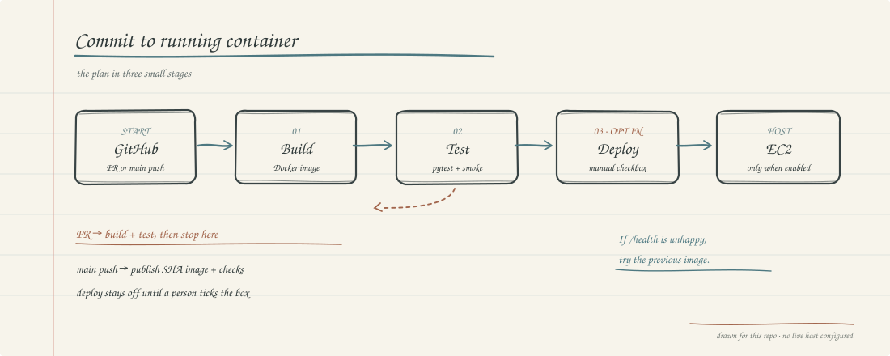

# CI/CD Pipeline for Containerized App Deployment

[](https://github.com/SAMSAROHA/ci-cd-pipeline-for-containerized-app-deployment/actions/workflows/ci-cd.yml)

A minimal Flask service packaged as a non-root Docker container, with a GitHub Actions workflow for image build, automated checks, and gated deployment to an EC2 host. The workflow uses immutable commit SHA image tags and checks application health before accepting a deployment.

> **Project state:** GitHub Actions has run build and test. The first deployment attempt stopped with `Error: missing server host` because no EC2 host was configured. No EC2 connection was made. Deployment is now opt-in and defaults to off.

## Pipeline at a glance



Pull requests build the image and run unit and container smoke checks. A push to `main` publishes the SHA-tagged image to GHCR and runs both checks. **Production deployment is opt-in:** use the `workflow_dispatch` form and enable its `deploy` checkbox only after configuring the host and secrets. It defaults to off, so pushes and ordinary manual CI runs do not contact EC2.

## Repository layout

```text
.
├── .github/workflows/ci-cd.yml   # Build, test, and deploy jobs
├── docs/
│   ├── DEPLOYMENT.md             # Deferred GitHub and EC2 setup
│   ├── TROUBLESHOOTING.md        # Failure guide and evidence log
│   └── images/                   # Architecture diagrams
├── src/cicd_demo/app.py          # Flask application
├── tests/test_app.py             # Route tests
├── Dockerfile
├── compose.yaml
├── pyproject.toml                # Python project and pytest settings
├── requirements.txt              # Runtime dependencies
└── requirements-dev.txt          # Local/CI test dependencies
```

## Service endpoints

| Method | Path | Response | Purpose |
| --- | --- | --- | --- |
| `GET` | `/` | `{"message":"Hello from CI/CD","version":"1.0"}` | Example application response |
| `GET` | `/health` | `{"status":"ok"}` | Container and deployment health check |

Gunicorn listens on container port `8080`. The container runs as an unprivileged `appuser` and includes a Docker health check for `/health`.

## Run locally

Prerequisites: Python 3.12 and Docker Engine/Desktop. On Windows PowerShell:

```powershell
py -3.12 -m venv .venv
.\.venv\Scripts\Activate.ps1
python -m pip install -r requirements-dev.txt
python -m pytest -q
```

On macOS or Linux, create and activate the environment with:

```sh
python3.12 -m venv .venv
. .venv/bin/activate
python -m pip install -r requirements-dev.txt
python -m pytest -q
```

Build and run the container:

```sh
docker build --tag cicd-demo:local .
docker run --rm --publish 8080:8080 --name cicd-demo cicd-demo:local
```

In another terminal, open `http://localhost:8080/` and `http://localhost:8080/health`. Stop the service with Ctrl+C. Or use `docker compose up --build` and stop it with Ctrl+C.

## CI/CD behavior

| Stage | Pull request to `main` | Push to `main` | Manual run (`deploy` off / on) |
| --- | --- | --- | --- |
| Build | Builds the container locally in the runner | Builds and publishes `ghcr.io/<owner>/<repo>:<commit-sha>` | Off: local build / On: publishes SHA image |
| Test | Runs pytest and a container health smoke test | Runs pytest and tests the published image | Runs pytest and smoke test |
| Deploy | Skipped | Skipped | Off: skipped / On: runs after checks, using `production` |

The workflow uses `GITHUB_TOKEN` for GHCR. The deploy job pulls the image on the server, replaces the `app` container, checks `/health`, and attempts to restore the previous image if the new container fails. If you want to keep this project fully off EC2, leave the manual `deploy` checkbox off; build and test can still run. If you dispatch from a branch other than `main`, the workflow tests a local image and skips deploy. Review the known limitations in [Deployment setup](docs/DEPLOYMENT.md) before enabling deployment.

## Configure a future deployment

Deployment is disabled by default. Follow [docs/DEPLOYMENT.md](docs/DEPLOYMENT.md) only when you are ready to configure GitHub secrets and an EC2 host. It explains the required secrets, registry visibility, environment protection, and SSH network tradeoffs.

## Troubleshooting and evidence

[docs/TROUBLESHOOTING.md](docs/TROUBLESHOOTING.md) lists common failure patterns and records the observed missing-host failure from the initial Actions run, along with the workflow change that prevents an accidental production attempt.

## Resume wording

Accurate for the current project state:

> Built a Flask application container and authored a three-stage GitHub Actions workflow for image build, automated tests, and health-checked EC2 deployment with rollback logic.

After a successful live deployment, you can add measured outcomes and real troubleshooting examples. Do not claim the pipeline eliminated manual production deployment or that specific failures were fixed until those results have been demonstrated.
