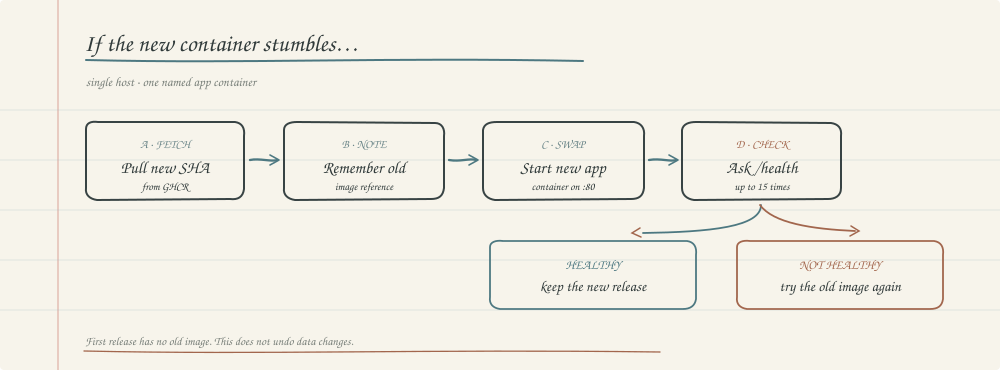

# Deployment setup (deferred)

This guide documents the workflow's expected GitHub and EC2 configuration. It does not create cloud resources or run a deployment. The deployment job in `.github/workflows/ci-cd.yml` activates only for pushes to `main` after build and test pass.

## What the workflow expects

- A Linux EC2 host with Docker and `curl` installed.
- A dedicated SSH deploy key accepted by the deployment user.
- The host can reach GHCR and pull the image published by the workflow.
- TCP port 80 is available for the application; SSH access is restricted according to your network policy.
- GitHub Actions secrets `EC2_HOST`, `EC2_USER`, and `EC2_SSH_KEY`.
- A GitHub Actions environment named `production`, ideally with required reviewers.

## Setup sequence

1. Create the server and network rules in your own AWS account. Pick an OS image and instance size that fit your account and budget. Do not assume a size is free-tier eligible without checking current AWS terms.
2. Install Docker and `curl`; create a deployment account with only the access the workflow needs.
3. Generate a dedicated SSH key pair. Add only the public key to the deployment account's `authorized_keys`; store the complete private key in GitHub as `EC2_SSH_KEY`.
4. Add `EC2_HOST` and `EC2_USER` as GitHub Actions secrets, and add `EC2_SSH_KEY` to the `production` environment if using environment-scoped secrets.
5. Confirm the GHCR package is pullable from the server. Public package access avoids storing a registry credential on the host; if the package is private, configure a narrowly scoped read credential on the host before enabling deploy.
6. Protect `main` with required build/test checks and configure `production` reviewers before allowing a deployment.
7. When ready, make a controlled push to `main`, observe the workflow and verify the service from the server. Record the run link and result in [TROUBLESHOOTING.md](TROUBLESHOOTING.md).

## Network and access tradeoffs

GitHub-hosted runner addresses change. A broad SSH ingress rule exposes the SSH service to the internet; key-only authentication does not remove that exposure. Prefer a deployment path with a restricted network boundary or a self-hosted runner in a controlled network. If using a hosted runner, apply the narrowest feasible rule and monitor access. Never commit private keys or credentials.

## Rollback behavior and limits

The workflow records the image reference used by the currently named `app` container, removes that container, starts the new SHA-tagged image, and polls `/health`. If startup or health verification fails, it attempts to remove the new container and start the previous image reference. This is a single-host, single-container demonstration; it has no load balancer, traffic draining, persistent data migration, or multi-instance availability. A successful HTTP health response also does not prove every user journey works.

The first deployment has no prior image to restore. In that case a failed deploy removes the failed container and exits with an error; it cannot roll back to a version that was never deployed.
